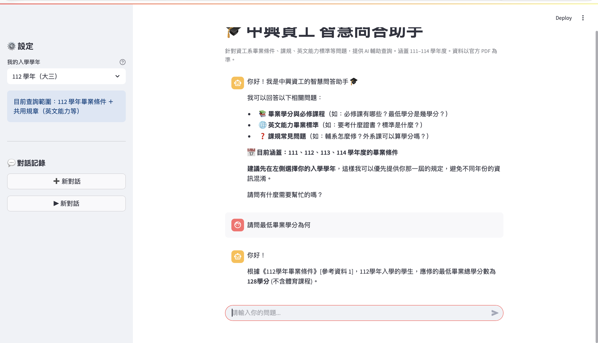
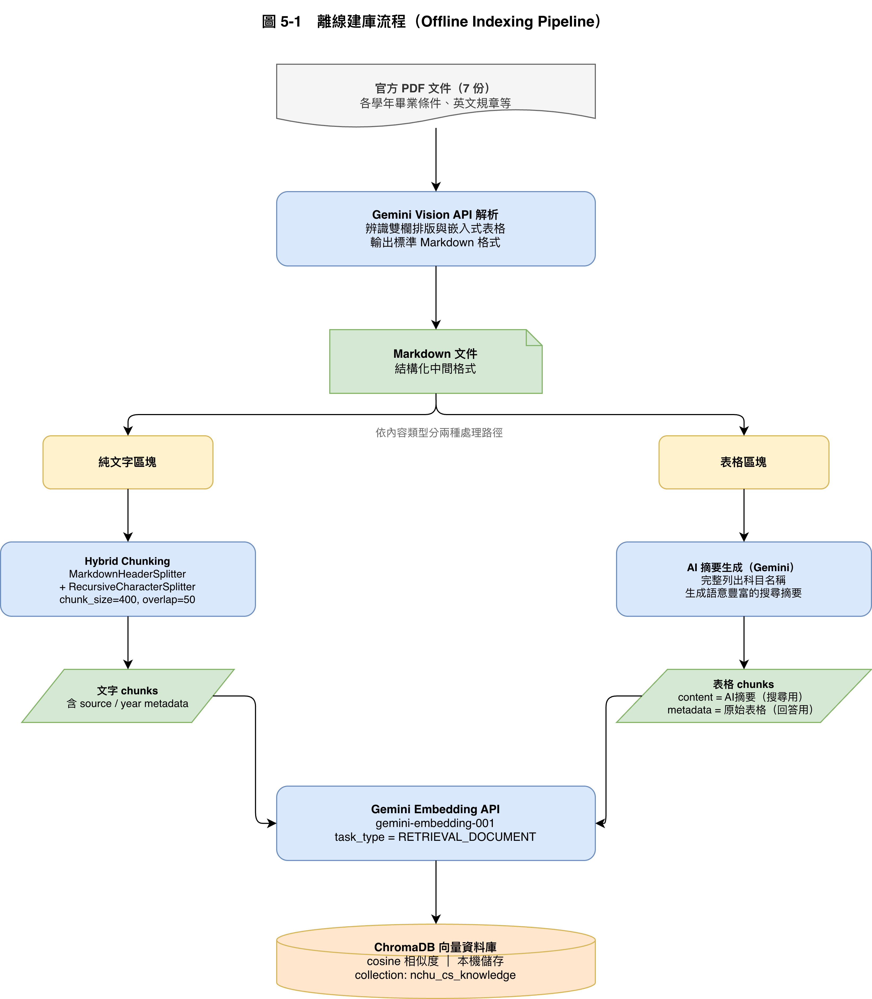
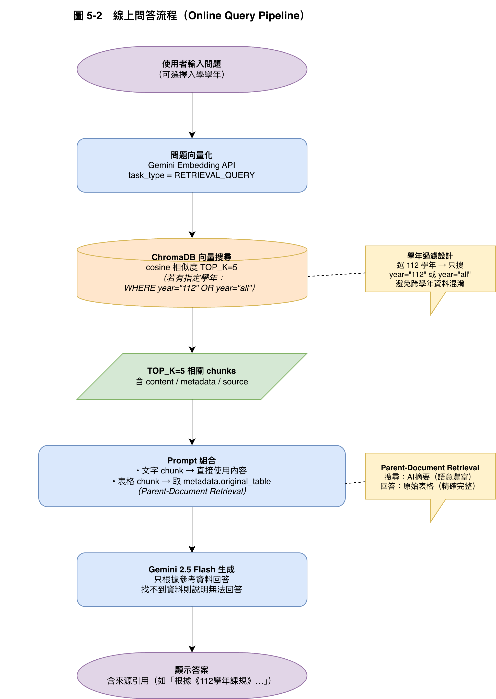

# NCHU CSE RAG Q&A Assistant

**[中文](README.md)**

A Retrieval-Augmented Generation (RAG) assistant that answers questions about graduation requirements, required courses, and English proficiency rules for the Department of Computer Science and Engineering at National Chung Hsing University (NCHU). Every answer cites the official document it is based on.

On a 10-question benchmark, the system scored **18/20 (90%)**, compared with **2/20 (10%)** for plain Gemini without retrieval.



> The interface and the source documents are in Traditional Chinese.

## Motivation

The department's rules are spread across several PDFs, differ by enrollment year, and live largely in two-column layouts and tables. General-purpose LLMs tend to invent credit numbers when asked. This system first retrieves the relevant passages from the official documents, then has the model answer from them.

## Architecture

| Offline indexing | Online querying |
|---|---|
|  |  |

**Offline indexing (`run_pipeline.py` → `ingest.py`)**

1. Gemini Vision converts each PDF to Markdown, handling the two-column layouts and tables that conventional PDF parsers garble.
2. Plain text is split by Markdown headers, then into 400-character chunks with 50-character overlap.
3. Gemini writes a summary of each table. The summary is embedded for search; the original table is kept in metadata.
4. Chunks are embedded with `gemini-embedding-001` and stored in ChromaDB using cosine similarity.

**Online querying (`rag.py`, `app.py`)**

1. The question is embedded and the top 5 chunks are retrieved from ChromaDB.
2. If the user selects an enrollment year, search is restricted to that year plus documents shared across years.
3. When vector search confidence is low, keyword matching against the original tables is used as a fallback.
4. The prompt goes to Gemini 2.5 Flash. Table chunks contribute the full original table, not the summary.
5. The Streamlit UI passes the last 3 turns of conversation so the model can resolve references like "that course".

## Key design decisions

- **Parent-document retrieval for tables.** Raw tables embed poorly, so search runs against an AI-written summary while the answer is generated from the original table. The summary makes the table findable; the original keeps the answer exact.
- **Enrollment-year filtering.** Required credits differ by year. Each chunk carries a `year` tag, and queries filter on metadata so rules from different years don't get mixed.
- **Keyword fallback.** Exact strings such as course names get diluted in semantic embeddings. When the best distance exceeds a threshold, the system adds results from string matching against the original tables.

## Evaluation

The baseline is plain Gemini given no documents; the treatment is this system. The 10 questions cover credits, required courses, and English standards for enrollment years 111–114, each scored 0–2.

| Group | Score | Accuracy |
|---|---|---|
| Baseline (plain Gemini) | 2 / 20 | 10% |
| This system | 18 / 20 | 90% |

The one miss was Q5 (whether "Introduction to Database Management Systems" is required for the 112 cohort). `diagnose_q5.py` separates two candidate causes: the summary embedding being diluted by a long course list, or the table losing its section-heading context when extracted.

The full method and analysis are in the [competition report](docs/competition_report.pdf) (Chinese).

## Getting started

Requires Python 3.10+ and a [Google AI Studio](https://aistudio.google.com/) API key.

```bash
git clone <this-repo-url>
cd nchu-cse-rag-assistant
python -m venv .venv
source .venv/bin/activate        # Windows: .venv\Scripts\activate
pip install -r requirements.txt
cp .env.example .env             # then set GOOGLE_API_KEY in .env
```

### Data

The department's source PDFs and the vector database are **not included**. Obtain the documents yourself and place them in the repo root, using the filenames listed in `PDF_CONFIGS` in `run_pipeline.py` (see the table in the [Chinese README](README.md#準備資料)). Missing files are skipped. To adapt the system to another department, edit `PDF_CONFIGS`.

### Run

```bash
python run_pipeline.py    # PDF → Markdown → chunks (writes all_chunks.json)
python ingest.py          # chunks → embeddings → chroma_db/
streamlit run app.py      # open http://localhost:8501
```

Other scripts:

```bash
python experiment.py      # baseline vs RAG, writes experiment_results.md
python diagnose_q5.py     # diagnose the Q5 miss
python check_models.py    # list Gemini models available to your key
```

## Project structure

```
.
├── app.py              Streamlit chat UI
├── rag.py              Retrieval and generation core; exposes ask()
├── run_pipeline.py     Offline preprocessing: PDF → Markdown → chunks
├── ingest.py           Builds the ChromaDB vector store
├── experiment.py       RAG vs plain-LLM experiment
├── diagnose_q5.py      Failure analysis for Q5
├── check_models.py     Lists available models
├── legacy/             Early single-PDF prototype (superseded)
└── docs/
    ├── competition_report.pdf
    └── images/
```

## Tech stack

Python · Google Gemini 2.5 Flash · gemini-embedding-001 · ChromaDB · LangChain Text Splitters · Streamlit

## Limitations

- Answer quality depends on how accurately the PDFs and tables are parsed and summarized. Official department announcements remain authoritative.
- The knowledge base covers enrollment years 111–114 and the seven documents listed above.
- Out-of-scope questions are handled by a prompt instruction to say no answer was found, not by a separate classifier.

## Team

Undergraduate capstone project, Department of Computer Science and Engineering, NCHU (2025–2026)

- 鄭仲軒: system design, implementation, experiments
- Teammate (name withheld): literature review, test question design, project coordination
